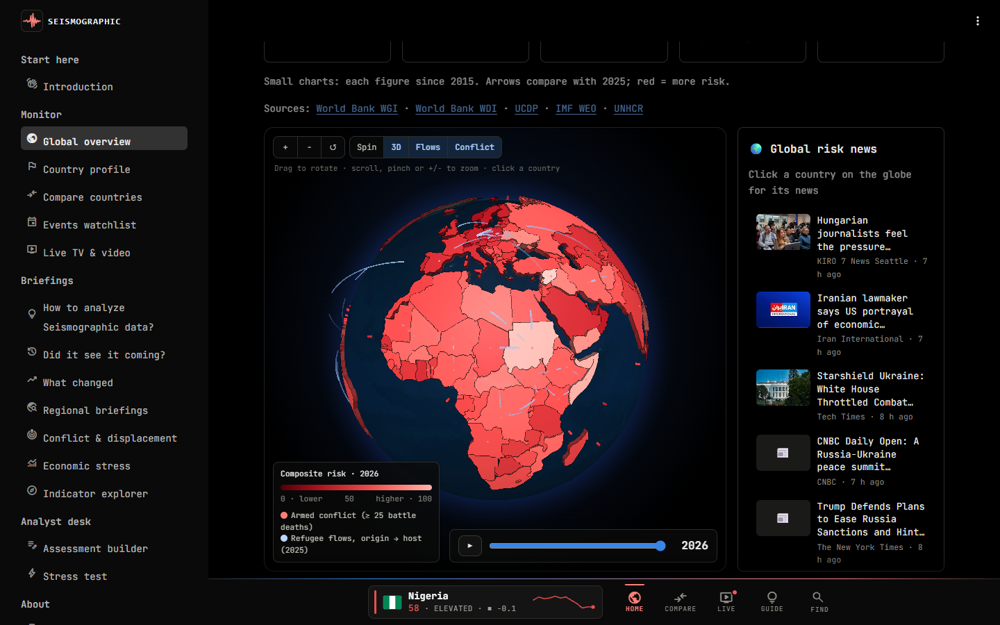
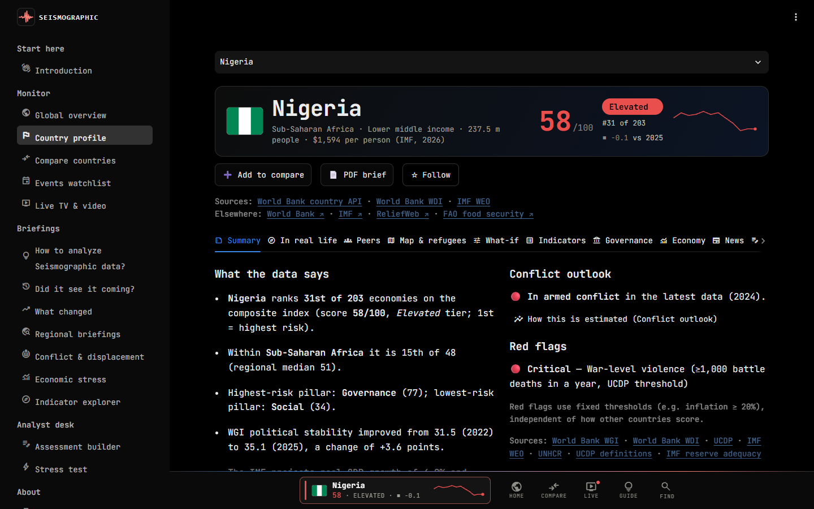
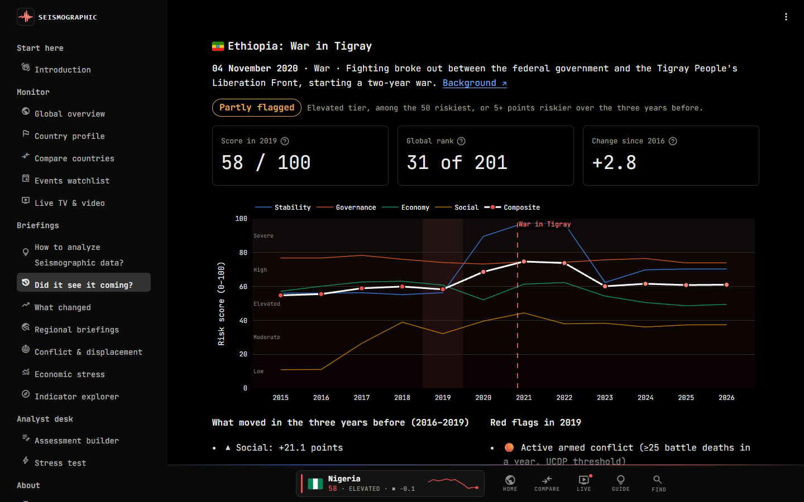
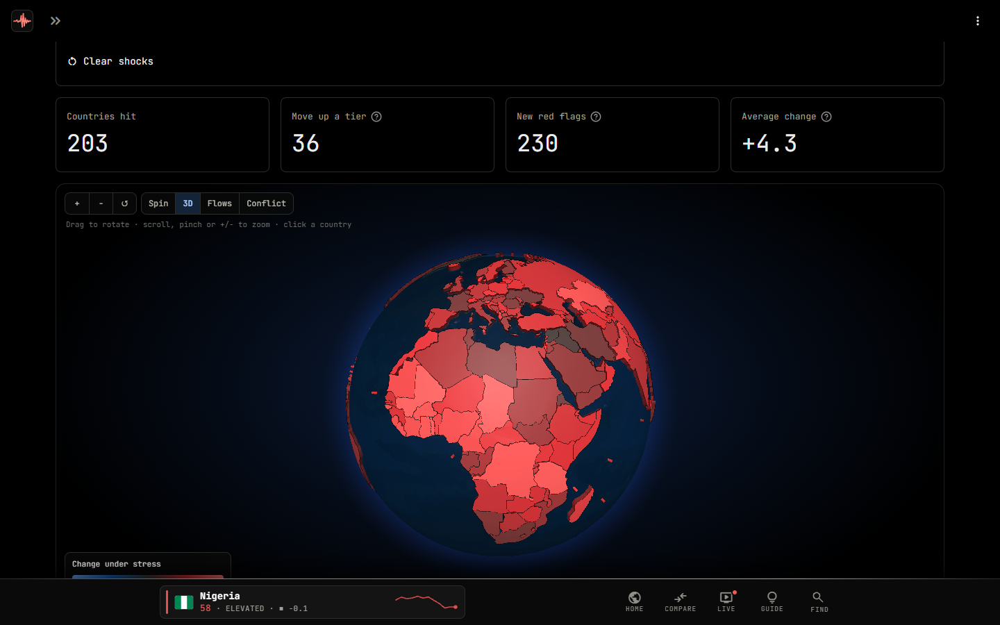
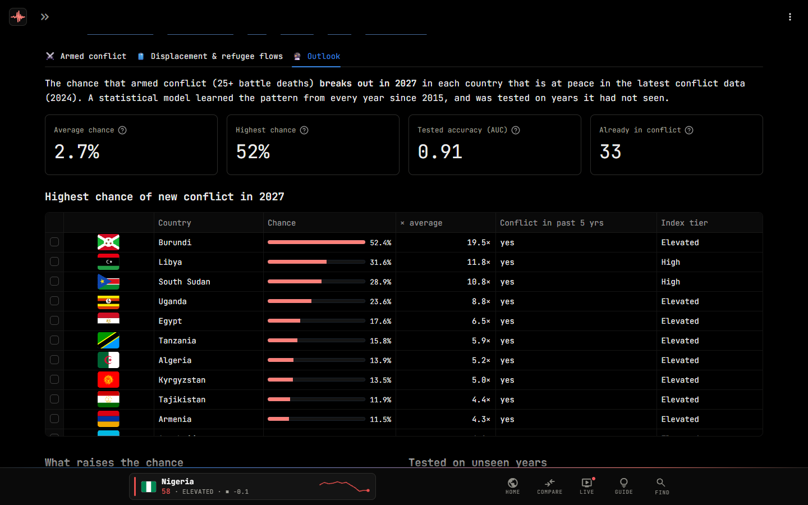
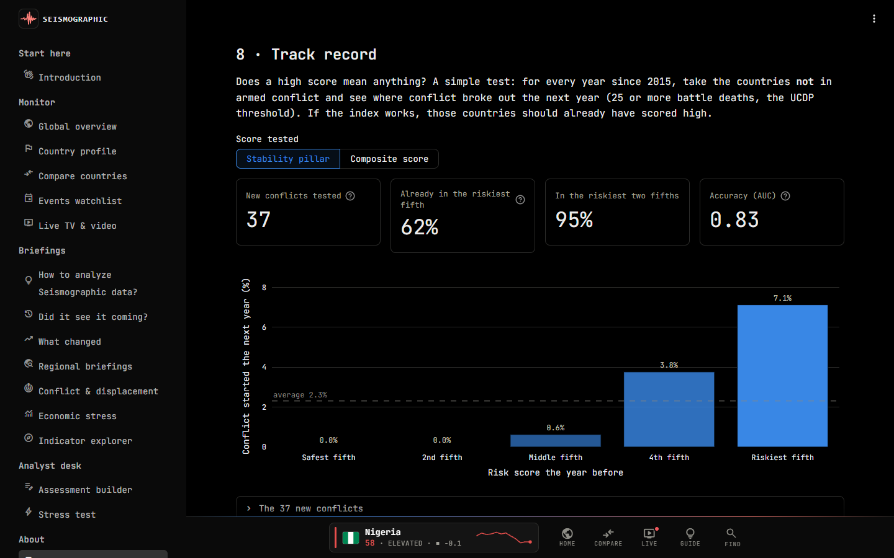
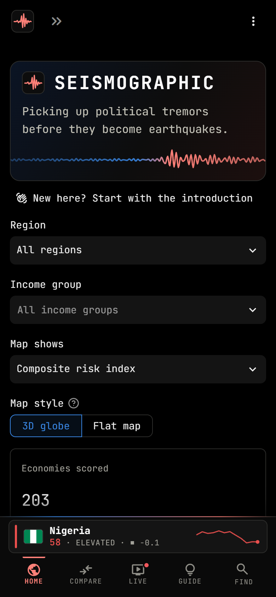

# Seismographic

**Picking up political tremors before they become earthquakes.** A transparent country-risk index built from open
data, with an analyst's judgment on top.

🔗 **Live app:** https://YOUR-APP-NAME.streamlit.app  *(replace after deploying)*

Seismographic scores around 200 economies on political, governance, economic and social risk using live data from the
World Bank, IMF, UNHCR and the Uppsala Conflict Data Program. It follows the structure professional country-risk
models use — indicators → pillars → a weighted composite — and shows every step, so a reader can see *why* a
country scores the way it does and challenge the assumptions.

On top of the model sit the parts a model cannot do: **red flags** on absolute thresholds, a **live news pulse**,
an **events watchlist**, and **written analyst assessments** with probabilistic key judgments and scenarios.

<p align="center"></p>

| Country profile | Did it see it coming? |
|---|---|
|  |  |
| **Stress test** | **Conflict outlook** |
|  |  |
| **Track record** | **On a phone** |
|  |  |

## What you can do in the app

| Page | What it shows |
|---|---|
| **Introduction** | What the tool is, how the score is built (indicators → risk scores → pillars → composite and tiers), the four pillars and their weights, a map of every page, a quick start and the caveats |
| **Global overview** | Interactive 3D globe — rotate, zoom, click any country (small states are dots) to see its index and **its latest news**, replay the index year by year since 2015, pulsing rings where armed conflict is active, animated refugee-flow arcs — or a flat map; the countries you **follow** at the top; headline numbers with sparklines and year-on-year changes; risk matrix, tier distribution by region, sortable ranking with flags and 1-year change arrows, biggest movers in political stability |
| **Country profile** | Composite score and rank (with trend and change vs last year), a **☆ Follow** button (remembered in the browser, no account), automatic data brief, the **conflict outlook** for next year, red flags, pillar scores vs regional median, **risk over time** since 2015, sensitivity check, a **what-if simulator** (move indicator sliders or pick a scenario such as *currency crisis* or *armed conflict* and watch the score, tier and rank update), every indicator with its year and source, WGI trends with confidence intervals, IMF macro charts with projections, live risk-related headlines, protest coverage over three months, the **countries with the most similar risk profile**, links to the country's pages at the World Bank, IMF, ReliefWeb and FAO, a **one-page PDF brief** to download, and the analyst assessment |
| **Compare countries** | Up to six countries — add them from any profile with *Add to compare* or from the *similar to* suggestions; the address is a **shareable link** to the comparison: pillar radar, governance over time, indicator table, economic trajectories |
| **Events watchlist** | Elections, deadlines and other dated events on a timeline |
| **Live TV & video** | 25 round-the-clock live news channels from five regions (Europe, the Americas, the Middle East, Africa and Asia-Pacific), each labelled with where it is based and who owns it, plus the latest video reports, think-tank analysis (CFR, Crisis Group, Carnegie, Brookings, Atlantic Council, CSIS) and briefings from institutions and NGOs (UN, IMF, World Bank, ICRC, Human Rights Watch), filterable by country; each profile also shows the videos about that country |
| **How to analyze Seismographic data?** | What the numbers mean in real life: a plain-language reading of any country, what each tier, pillar and warning threshold looks like on the ground, practical steps for business, NGOs, travel and research, and the tool's limits. Each country profile also has an *In real life* tab with the same reading |
| **Did it see it coming?** | Eight shocks since 2020 (the coups in Myanmar and Niger, the wars in Tigray and Sudan, the fall of Kabul, Russia's invasion of Ukraine, Sri Lanka's default and Bangladesh's uprising) and what the index said about each country the year before, with a verdict from a fixed, published rule and room for analyst commentary |
| **What changed** | This year vs last: biggest risers and fallers, tier changes, the pillar that drove each move, red flags newly crossed or cleared |
| **Regional briefings** | One region at a time: headline numbers with trends, zoomed map, tier mix since 2015, risers and fallers, ranking, upcoming events and regional news |
| **Conflict & displacement** | Battle deaths worldwide and by conflict, a table of active wars and conflicts, displacement over time, largest origin and host countries, the 25 largest refugee corridors, and the **Outlook**: the chance of new armed conflict next year in every country at peace, from a small statistical model tested out of time |
| **Economic stress** | A heatmap of inflation, growth, debt, deficits, current account and reserves, a growth-vs-inflation (stagflation) chart, the IMF outlook, and countries crossing several warning thresholds |
| **Indicator explorer** | Any of the 17 indicators on the 3D globe, with its distribution and the riskiest and safest 10 countries |
| **Assessment builder** | A form that turns your analysis into a structured assessment file (BLUF, key judgments with ICD 203 estimative language, drivers, scenarios, signposts) |
| **Stress test** | Hit many countries at once with one economic shock (a 2009-style recession, a 2020-style pandemic, a 2022-style price surge, higher-for-longer rates, or your own) and see who crosses a risk tier or a red flag, on the globe and in a table; filter by region and income group, share the link, download the results |
| **Methodology** | Every indicator, normalisation, weight, threshold and limitation, plus two tests of the model: its **track record** before new armed conflicts and a **benchmark** against the Fragile States Index |
| **Glossary & legend** | 122 terms in nine colour-coded categories, each with its icon and the sources behind it, searchable; every term links to the organisation that defines or publishes it; plus a visual legend for tiers, pillars, colour scales and globe layers |
| **Sources & citations** | Every dataset, definition and feed behind the tool, with links, update dates and the status of the data loaded now; the source of every warning threshold; independent indices to cross-check the scores against; who owns each video channel; and how to cite the tool |
| **Download data** | Every table behind the index (the index, all 17 indicators with years and scores, red flags, history since 2015, the conflict outlook) as CSV, one Excel workbook or JSON, with a data dictionary; where the app runs as an ASGI app, a read-only **JSON API** too |
| **Resources** | Curated data sources, professional outlooks, tradecraft guides and books |

Most pages open on their own **3D globe**: the overview (with a live news column and hotspots to watch), regional
briefings (turned to the region), conflict & displacement (conflict rings and refugee arcs), economic stress, a
diverging *map of change* on *What changed*, the compared countries on *Compare*, upcoming events on the
watchlist, and each country's own refugee links on its profile. Every chart, map and table names its sources
underneath, with links.

A **console bar** along the bottom of every page keeps the tracked country one tap away (flag, score, tier,
change and a small seismogram of its risk since 2015) next to tabs for Home, Compare, Live and Guide and a
*Find* sheet for countries and pages.

## Method in brief

* **17 indicators in 4 pillars**: Political Stability & Violence (35%), Governance & Institutions (25%),
  Macroeconomic & Financial (25%), Social & Humanitarian Pressure (15%). Weights are adjustable in the app.
* **Normalisation**: percentile ranks (0 = lowest risk in the sample, 100 = highest); battle deaths and
  displacement use a capped log scale so that "no conflict" scores zero.
* **Aggregation**: arithmetic mean within pillars, weighted mean across pillars, with minimum-data rules.
* **Robustness**: sensitivity check on every profile; WGI changes tested against 90% confidence intervals.
* **Red flags**: absolute thresholds (e.g. UCDP's 25 battle-death threshold for armed conflict, reserves below
  three months of imports) to complement the relative index.
* **Conflict outlook**: a penalised logistic regression (numpy, no black box) on the four pillars, low-level
  violence and conflict in the past five years gives each country at peace a chance of new armed conflict next year.
* **Stress test**: shocked countries are scored against today's distribution, so a shock that hits every country
  still shows (re-ranking everyone against each other would hide it).

### Does it work?

* **Track record.** Of the 37 armed conflicts that broke out between 2015 and 2024 in countries that were at peace
  the year before, 62% started in countries already in the riskiest fifth on the stability pillar, and 95% in the
  riskiest two fifths (AUC 0.83, where 0.5 is a coin flip).
* **Benchmark.** Against the Fragile States Index (2023), the two rankings correlate at 0.86 and agree on 15 of
  the 20 riskiest countries; the Methodology page lists where they disagree and why.
* **Conflict outlook, tested out of time.** Each year from 2019 to 2023 was predicted by a model fitted only on
  earlier years: accuracy (AUC) 0.91, Brier skill +0.12 against the average rate, and the fifth given the highest
  chances averaged 10.7% predicted against 10.5% observed (764 cases, 19 new conflicts).
* **Case studies.** Of eight major shocks since 2020, the index flagged three outright the year before and partly
  flagged the other five.

These figures are from the data snapshot of October 2026 and move a little as the data are revised. The scores are
rebuilt with today's data, so the tests show that the index ranks countries sensibly, not that it predicts events.

Full details are on the in-app *Methodology* page; the logic lives in [`prm/scoring.py`](prm/scoring.py) and every
indicator, weight and threshold is defined in [`prm/config.py`](prm/config.py).

## Data sources

| Source | Used for | Access |
|---|---|---|
| [World Bank Worldwide Governance Indicators](https://www.worldbank.org/en/publication/worldwide-governance-indicators) | Six governance dimensions (2025 methodology, 0–100 scores) | Public API |
| [World Bank World Development Indicators](https://datatopics.worldbank.org/world-development-indicators/) | Population, battle deaths (UCDP), homicides, reserves, unemployment | Public API |
| [IMF World Economic Outlook](https://www.imf.org/external/datamapper) | Growth, inflation, debt, fiscal and current-account balances, projections | Public API |
| [UNHCR Refugee Data Finder](https://www.unhcr.org/refugee-statistics/) | Forcibly displaced people by origin | Public API |
| [Bing News](https://www.bing.com/news) and [Google News](https://news.google.com/) (RSS search) | Live risk-related headlines with photos, refreshed every 10 minutes | Public feeds |
| [GDELT Project](https://www.gdeltproject.org/) | Backup news source, media tone and protest coverage | Public API |
| [Fragile States Index](https://fragilestatesindex.org/) (The Fund for Peace) | Benchmark on the Methodology page (not used in the score; downloaded from the publisher when needed, not stored here) | Public download |
| [IFES ElectionGuide](https://www.electionguide.org/) | Dates for the events watchlist | Website |

Pages open instantly from the snapshot in `data/snapshot/` (refreshed monthly by a GitHub Action) while the
live data downloads in the background; live data is then kept for 12 hours, and any source that is down keeps
its snapshot copy. The risk-over-time view recomputes the index for every year since 2015 with the data
available for that year. The 3D globe draws [Natural Earth](https://www.naturalearthdata.com/)
country outlines (public domain) with [globe.gl](https://globe.gl/).

## Project structure

```
streamlit_app.py          entry point and navigation
app_pages/                one file per page
prm/config.py             indicators, pillars, weights, tiers, thresholds
prm/sources.py            API clients (World Bank, IMF, UNHCR, GDELT)
prm/scoring.py            normalisation, aggregation, red flags, automatic brief
prm/charts.py             Plotly charts
prm/globe.py              interactive 3D globe (custom Streamlit component)
prm/data.py               caching and snapshot fallback
prm/validation.py         track record: did high scores come before armed conflict?
prm/forecast.py           conflict outlook model and its out-of-time test
prm/stress.py             stress test: shocks, scenarios and re-scoring
prm/export.py             open-data tables, data dictionary, Excel and JSON
prm/api.py                read-only JSON API (served by asgi.py)
prm/follow.py             the Follow button (browser storage component)
asgi.py                   the app as an ASGI app, with the API
prm/cases.py              case studies and their verdict rule
prm/report.py             one-page PDF country brief
assessments/              analyst assessments, one Markdown file per country
case_studies/             analyst commentary on the case studies (optional)
data/events.csv           events watchlist
scripts/refresh_snapshot.py  saves an offline copy of all data and the index history
scripts/check_watchlist.py   checks the watchlist still covers the next six months
tests/                    tests for the model and every page
```

## Automation

* **Tests** run on every push: the scoring model, the analysis tools, the PDF brief and every page and country
  tab (GitHub Actions, *Tests*).
* **Monthly data snapshot** on the 3rd of each month, including the index history ready-made so the first visit is
  fast (*Refresh data snapshot*). A download that covers far fewer countries than the saved copy is rejected, and
  the new snapshot is only committed if the full test suite passes on it.

### When something fails

* **A source is down or answers oddly:** live data that cannot be scored, or covers too few countries, is never
  shown; the app keeps the last good copy and tries again every 15 minutes. News, video, media tone and the FSI
  benchmark retry after 5 minutes instead of staying "unavailable".
* **A section breaks:** news, video, globes and benchmarks fail on their own with a one-line note; a page that
  breaks shows a friendly message with *Try again* instead of a stack trace (details go to the server log).
* **No WebGL or no CDN:** the 3D globe says why it cannot draw (with *Try again* if a download failed), and the rest
  of the page works.
* **Checked:** every country on every profile tab, and every page with extreme weights, malformed links and each
  region filter, all with the network switched off.
* **Weekly watchlist check** every Monday: if fewer than eight events fall in the next six months, it opens a
  reminder issue, and closes it once the list is topped up (*Watchlist check*).

## Run it yourself

```bash
pip install -r requirements.txt
streamlit run streamlit_app.py
```

Run the tests with `pip install pytest httpx` and then `python -m pytest`.

To serve the app together with the JSON API, run it as an ASGI app:

```bash
uvicorn asgi:app --port 8501
```

```
GET /api/v1                     what is available
GET /api/v1/countries           the index today (filter with ?region=, ?income=, ?tier=)
GET /api/v1/countries/KEN       one economy: scores, indicators, red flags, history, conflict outlook
GET /api/v1/dictionary          what every field means
```

`streamlit run` (and so Streamlit Community Cloud) has no custom routes, so there the API is absent and the
Download data page hides it.

Publishing on Streamlit Community Cloud (or, without the "Hosted with Streamlit" badge, on Hugging Face Spaces or, experimentally, Vercel) is
described step by step in [DEPLOY.md](DEPLOY.md). The `Dockerfile` also runs it on Render, Fly.io or any Docker host.

## Limitations

The index is relative and largely backward-looking: governance data describe the previous year and conflict data
lag by up to a year. Governance indicators are perception-based and carry margins of error. Countries with the
least data are often those with the most risk. The score is a structured starting point for analysis, not a
forecast — which is why the assessments exist.

## Author

**Tuan Dung Nguyen** — International Relations student.

Research design, indicator selection and all country assessments are my own.

## Licence

Code: MIT (see [LICENSE](LICENSE)). Data remain subject to each provider's terms; please cite the original sources.
