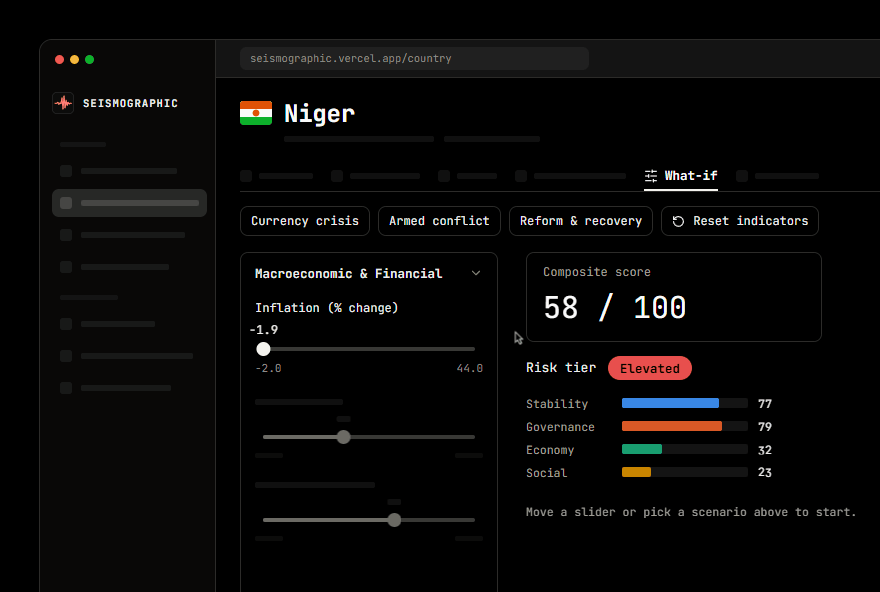
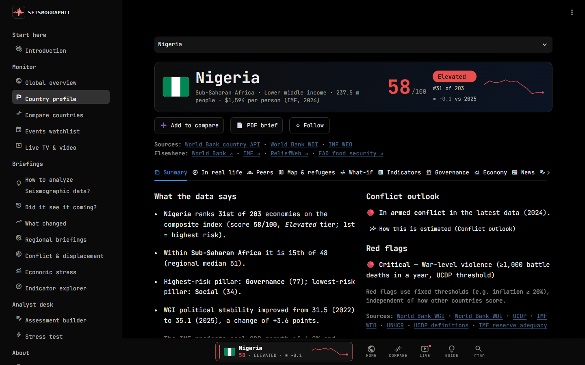
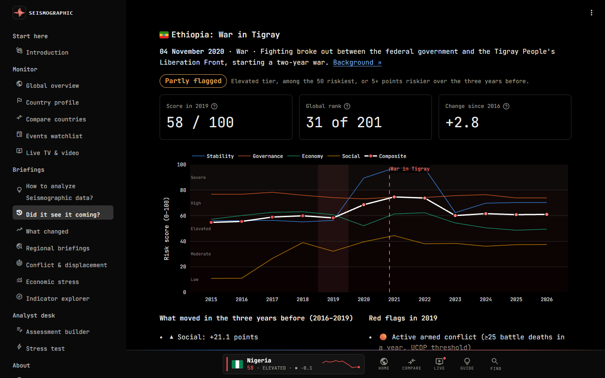
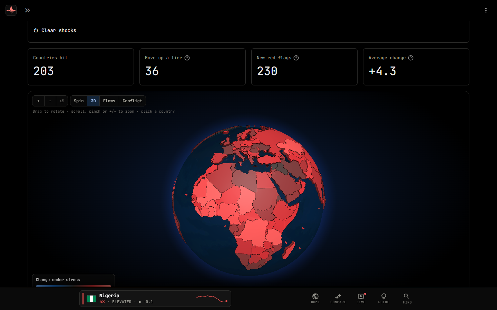
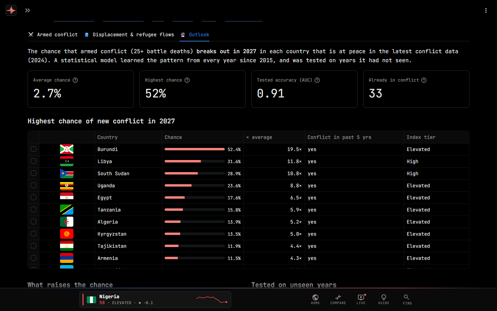
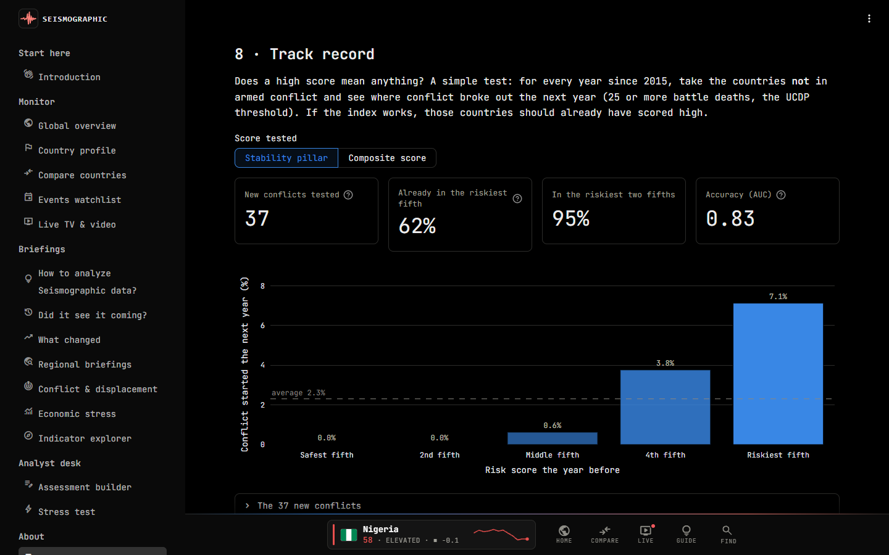
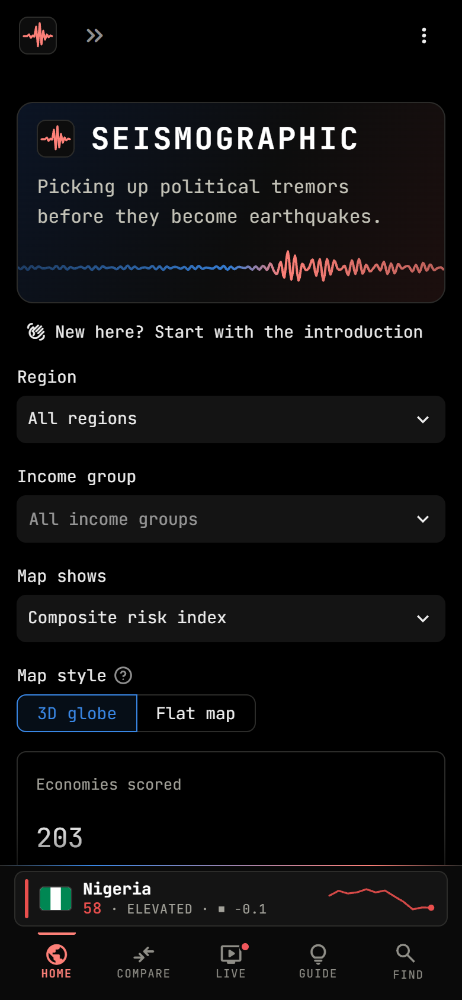

# Seismographic

A country risk index built from open data, with room for an analyst's judgment.

Live app: https://seismographic.vercel.app

Seismographic scores around 200 economies on political, governance, economic and social risk using live data from the
World Bank, IMF, UNHCR and the Uppsala Conflict Data Program (UCDP). It follows the structure professional country-risk
models use (indicators, then pillars, then a weighted composite) and shows every step, so a reader can see why a
country scores the way it does and question the assumptions.

The app adds what the model cannot do: red flags on absolute thresholds, live news, an events watchlist and
written analyst assessments with probabilistic key judgments and scenarios.

<picture>
  <source media="(prefers-reduced-motion: reduce)" srcset="docs/screenshots/what-if.png">
  
</picture>

| Country profile | Case studies |
|---|---|
|  |  |
| **Stress test** | **Conflict outlook** |
|  |  |
| **Track record** | **On a phone** |
|  |  |

## What you can do in the app

| Section | Page | What it shows |
|---|---|---|
| Monitor | **Global overview** | A 3D globe of the index (click a country for its score and news, replay every year since 2015, rings where armed conflict is active and refugee-flow arcs) or a flat map; the countries you follow; headline numbers with changes; tabs for hotspots, the biggest moves, the full ranking and a risk matrix by region |
|  | **Country profile** | Score, rank and tier with the change since last year, a ☆ Follow button, an automatic brief, the conflict outlook, red flags, pillar scores against the regional median, a seismogram of its risk since 2015, a sensitivity check, a what-if simulator, every indicator with its year and source, governance and IMF charts, news and protest coverage, the most similar countries, a one-page PDF brief and the analyst assessment (none published yet) |
|  | **Compare countries** | A pillar radar, governance over time, an indicator table and economic trajectories for up to six countries. Add them from any profile with *Add to compare* or from the *similar to* suggestions; the address is a shareable link to the comparison |
|  | **Score changes** | This year vs last: biggest risers and fallers, tier changes, the pillar that drove each move, red flags newly crossed or cleared |
|  | **Live video** | 25 live news channels from five regions, each labelled with where it is based and who owns it, plus recent video reports, think-tank analysis (CFR, Crisis Group, Carnegie, Brookings, Atlantic Council, CSIS) and briefings from the UN, IMF, World Bank, ICRC and Human Rights Watch, filterable by country |
| Briefings | **Regions** | One region at a time: headline numbers with trends, zoomed map, tier mix since 2015, risers and fallers, ranking, upcoming events and regional news |
|  | **Conflict & displacement** | Battle deaths worldwide and by conflict, a table of active wars and conflicts, displacement over time, largest origin and host countries, the 25 largest refugee corridors, and the Outlook: the chance of new armed conflict next year in every country at peace, from a small statistical model tested out of time |
|  | **Economic stress** | A heatmap of inflation, growth, debt, deficits, current account and reserves, a growth-vs-inflation (stagflation) chart, the IMF outlook, and countries crossing several warning thresholds |
|  | **Events watchlist** | Elections and other dated events on a timeline and a globe, counted for the next 90 days, the next 12 months and the past |
|  | **Case studies** | Eight shocks since 2020 (the coups in Myanmar and Niger, the wars in Tigray and Sudan, the fall of Kabul, Russia's invasion of Ukraine, Sri Lanka's default and Bangladesh's uprising) and what the index said about each country the year before, with a verdict from a fixed, published rule and room for analyst commentary |
| Tools | **Indicator explorer** | Any of the 17 indicators on the 3D globe, with its distribution and the riskiest and safest 10 countries |
|  | **Stress test** | Hit many countries at once with one economic shock (a 2009-style recession, a 2020-style pandemic, a 2022-style price surge, higher-for-longer rates, or your own) and see who crosses a risk tier or a red flag, on the globe and in a table; filter by region and income group, share the link, download the results |
|  | **Assessment builder** | A form that turns your analysis into a structured assessment file: BLUF (bottom line up front), key judgments in the estimative language of ICD 203 (the US intelligence community's analytic standards), drivers, scenarios and signposts; [assessments/README.md](assessments/README.md) says how to add it |
|  | **Data downloads** | Every table behind the index (the index, all 17 indicators with years and scores, red flags, history since 2015, the conflict outlook) as CSV, one Excel workbook or JSON, with a data dictionary; when the app runs as an ASGI app (see *Run it yourself*), a read-only JSON API too |
| Reference | **Introduction** | What the tool is, how the score is built (indicators, risk scores, pillars, then the composite and tiers), the four pillars and their weights, a quick start and the caveats |
|  | **Guide** | A plain-language reading of any country: what each tier, pillar and warning threshold looks like on the ground, what it means for business, NGOs, travel and research, and the tool's limits. Each country profile has the same reading under *What it means in real life* on its Summary tab |
|  | **Methodology** | Three tabs: how the index is built (every indicator, normalisation, weight and threshold), two tests of the model (its track record before new armed conflicts and a benchmark against the Fragile States Index) and its limits |
|  | **Glossary & legend** | 123 terms in nine colour-coded categories, searchable, most of them linked to the organisation that defines or publishes them; plus a visual legend for tiers, pillars, symbols and colour scales |
|  | **Sources** | Every dataset, definition and feed behind the tool, with links, update dates and the status of the data loaded now; where each warning threshold comes from; independent indices to cross-check the scores; who owns each video channel; how to cite the tool; and further reading |

Most pages have their own 3D globe: the overview (with a live news column and hotspots to watch), regions
(turned to the region), conflict & displacement (conflict rings and refugee arcs, beside the deadliest
conflicts), economic stress, a diverging *map of change* on *Score changes*, upcoming events on the watchlist, and
each country's own refugee links on its profile. Charts, maps and tables name their sources on
the same page or tab, with links.

A console bar along the bottom of every page keeps the tracked country one tap away (flag, score, tier and
change), with tabs for Home, Compare, Live and Guide and a *Find* sheet that searches every country and every
page (press / or Ctrl+K). On a wide screen with the sidebar open, the bar keeps the tracked country and *Find*
but drops the page tabs, which the sidebar lists. On the country profile the header already shows the
country, so the bar leaves the tracked country out.

## Method in brief

* 17 indicators in 4 pillars: Political Stability & Violence (35%), Governance & Institutions (25%),
  Macroeconomic & Financial (25%), Social & Humanitarian Pressure (15%). Weights are adjustable in the app, and custom weights travel in shared links.
* Normalisation uses percentile ranks (0 = lowest risk in the sample, 100 = highest); battle deaths and
  displacement use a capped log scale so that "no conflict" scores zero.
* Pillars are the plain mean of their indicators and the composite is the weighted mean of the pillars. A pillar
  needs half of its indicators, and a country three of its four pillars, to be scored.
* The composite falls into one of five tiers of 20 points each: Low (0 to under 20), Moderate, Elevated, High
  and Severe (80 to 100).
* Every profile has a sensitivity check (the score with equal weights and with each pillar's weight set to zero),
  and changes in the World Bank governance scores (WGI) are tested against their 90% confidence intervals.
* Red flags use absolute thresholds (e.g. UCDP's 25 battle-death threshold for armed conflict, reserves below
  three months of imports) next to the relative index.
* The conflict outlook is a penalised logistic regression written in numpy. From the four pillars, low-level
  violence (under 25 battle deaths a year) and conflict in the past five years, it gives each country at peace a
  chance of new armed conflict next year. Its coefficients are charted on the Outlook tab.
* The stress test scores shocked countries against today's distribution, so a shock that hits every country
  still shows (re-ranking everyone against each other would hide it).

### Does it work?

* Of the 37 armed conflicts that broke out between 2016 and 2024 in countries at peace the year before, 62%
  started in countries already in the riskiest fifth on the stability pillar and 95% in the riskiest two
  fifths. The AUC is 0.83: the chance that a country where conflict broke out had scored higher than one
  where it did not (0.5 is a coin flip, 1 is perfect).
* Against the Fragile States Index (FSI, 2023), the two rankings correlate at 0.86 and agree on 15 of the 20
  riskiest countries. The Methodology page lists where they disagree and why.
* The conflict outlook was tested out of time: the outbreaks of each year from 2020 to 2024 were predicted by
  a model fitted only on earlier years. Its AUC is 0.91 and its Brier skill +0.12, meaning its squared error
  was 12% lower than always guessing the average rate (0 is no better, 1 is perfect). The fifth of cases
  given the highest chances averaged 10.7% predicted against 10.5% observed (764 country-years, 19 new
  conflicts).
* Of eight major shocks since 2020, the index flagged three outright the year before and partly flagged the
  other five. Flagged means a High or Severe tier or a rank among the 25 riskiest; partly flagged means
  Elevated, a rank among the 50 riskiest, or 5 or more points riskier over the three years before.

These figures come from the data snapshot of October 2026 and shift slightly when the data are revised. Past
scores are rebuilt with today's revised data, so the track record, the benchmark and the case studies show how the
index ranks countries; they are not forecasts. The conflict outlook is the one forecast, and its test uses today's
data too.

Full details are on the in-app *Methodology* page. The scoring is in [`prm/scoring.py`](prm/scoring.py); the
indicators, weights, tiers and red-flag thresholds are in [`prm/config.py`](prm/config.py); the track record, the
outlook and the case studies are tested in `prm/validation.py`, `prm/forecast.py` and `prm/cases.py`, and the FSI
benchmark is computed on the Methodology page (`app_pages/methodology.py`).

## Data sources

| Source | Used for | Access |
|---|---|---|
| [World Bank Worldwide Governance Indicators](https://www.worldbank.org/en/publication/worldwide-governance-indicators) (WGI) | Six governance dimensions (2025 methodology, 0-100 scores) | Public API |
| [World Bank World Development Indicators](https://datatopics.worldbank.org/world-development-indicators/) | Population, battle deaths (from UCDP), homicides, reserves, unemployment and youth unemployment | Public API |
| [IMF World Economic Outlook](https://www.imf.org/external/datamapper) | Growth, GDP per capita, inflation, debt, fiscal and current-account balances, projections | Public API |
| [UNHCR Refugee Data Finder](https://www.unhcr.org/refugee-statistics/) | Forcibly displaced people by origin, and refugee flows between countries | Public API |
| [Bing News](https://www.bing.com/news) and [Google News](https://news.google.com/) (RSS search) | Live risk-related headlines with photos, refreshed every 10 minutes | Public feeds |
| [GDELT Project](https://www.gdeltproject.org/) | Backup news source, media tone and protest coverage | Public API |
| [YouTube](https://www.youtube.com/) channel feeds | The live channels and latest video reports on *Live video* | Public feeds |
| [Fragile States Index](https://fragilestatesindex.org/) (FSI, The Fund for Peace) | Benchmark on the Methodology page (not used in the score; downloaded from the publisher when needed, not stored here) | Public download |
| [IFES ElectionGuide](https://www.electionguide.org/) | Dates for the events watchlist | Website |

Pages open on the snapshot in `data/snapshot/`, which a GitHub Action saves every Monday, so no visitor waits for
the 40-60 second download of every source. A snapshot up to 10 days old is used as it is. An older one is shown
while the live data download in the background. Live data are then kept for 12 hours (one hour if a source
failed), and a source that is down keeps its snapshot copy. The risk-over-time view recomputes the index for every
year since 2015 from today's data for that year, later revisions included. The 3D globe draws [Natural Earth](https://www.naturalearthdata.com/)
country outlines (public domain) with [globe.gl](https://globe.gl/).

## Project structure

```text
streamlit_app.py             entry point and navigation
asgi.py                      the app as an ASGI app, with the API
app_pages/                   one file per page
prm/config.py                indicators, pillars, weights, tiers, thresholds
prm/sources.py               clients for the APIs and feeds (World Bank, IMF, UNHCR, GDELT, news, YouTube, FSI)
prm/data.py                  caching and snapshot fallback
prm/scoring.py               normalisation, aggregation, red flags, automatic brief
prm/interpret.py             the plain-language reading on the Guide and the profile's Summary tab
prm/validation.py            track record: did high scores come before armed conflict?
prm/forecast.py              conflict outlook model and its out-of-time test
prm/stress.py                stress test: shocks, scenarios and re-scoring
prm/cases.py                 case studies and their verdict rule
prm/content.py               reads the assessments and the events watchlist
prm/glossary.py              glossary terms and categories
prm/charts.py                Plotly charts
prm/globe.py                 interactive 3D globe (custom Streamlit component)
prm/ui.py                    shared page parts: sidebar, bottom bar, tables, error handling
prm/a11y.py                  page accessibility and the / and Ctrl+K shortcuts
prm/brand.py                 logo and banner artwork
prm/follow.py                the Follow button (browser storage component)
prm/report.py                one-page PDF country brief
prm/export.py                open-data tables, data dictionary, Excel and JSON
prm/api.py                   read-only JSON API (served by asgi.py)
assessments/                 analyst assessments, one Markdown file per country
case_studies/                analyst commentary on the case studies (optional)
data/events.csv              events watchlist
data/snapshot/               the saved data the app opens on
scripts/refresh_snapshot.py  saves an offline copy of all data and the index history
scripts/check_watchlist.py   checks the watchlist still covers the next six months
tests/                       tests for the model and every page
```

## Automation

* Tests run on every push and pull request: the scoring model, the analysis tools, the PDF brief, and every
  page and country tab on the saved snapshot (GitHub Actions, *Tests*).
* A data snapshot is saved every Monday, with the index history ready-made (*Refresh data snapshot*). A
  download that covers under 60% of the countries in the saved copy is rejected, and the new snapshot is only
  committed if the full test suite passes on it.
* A watchlist check runs every Monday: if fewer than eight events fall in the next six months, or a row has a
  date it cannot read, it opens a reminder issue, and closes it once the list is fixed (*Watchlist check*). To
  add events, run the app with the `SEISMOGRAPHIC_MAINTAINER` environment variable set to `1`: the watchlist
  then shows a helper that writes each line for `data/events.csv`.
* If a Hugging Face Space is set up (the `HF_SPACE` variable and the `HF_TOKEN` secret), every push to `main`
  and every snapshot refresh is published to it (*Publish to Hugging Face*).

### When something fails

* Live data that cannot be scored, or that covers too few countries (under 150 scored economies, or under
  60% of the saved copy), is never shown: the app keeps the last good copy and tries again every 15 minutes.
  News, video, media tone, protest coverage and the FSI benchmark retry after 5 minutes instead of staying
  "unavailable".
* If news, video, a globe or a benchmark breaks, it fails on its own with a one-line note. A page that breaks
  shows a plain message with *Try again* instead of a stack trace; the error type is under *Technical
  details* and the full trace goes to the server log.
* With no WebGL or no CDN, the 3D globe says why it cannot draw (with *Try again* if a download failed), and
  the rest of the page works.

## Run it yourself

Seismographic needs Python 3.12 or newer (the tests run on 3.14).

```bash
pip install -r requirements.txt
streamlit run streamlit_app.py
```

Run the tests with `pip install pytest httpx` and then `python -m pytest`.

To serve the app together with the JSON API, run it as an ASGI app (ASGI is the standard interface between Python
web apps and servers; uvicorn comes with Streamlit):

```bash
uvicorn asgi:app --port 8501
```

```text
GET /api/v1                     what is available
GET /api/v1/countries           the index today (filter with ?region=, ?income=, ?tier=)
GET /api/v1/countries/KEN       one economy: scores, indicators, red flags, history, conflict outlook
GET /api/v1/dictionary          what every field means
```

The live app runs this way on Vercel, so the API is public at https://seismographic.vercel.app/api/v1. Under
`streamlit run streamlit_app.py`, which Streamlit Community Cloud, Hugging Face Spaces and the `Dockerfile` use,
there are no custom routes: the API is absent and the Data downloads page hides it.

[DEPLOY.md](DEPLOY.md) explains how to publish on Streamlit Community Cloud, on Hugging Face Spaces (no
"Hosted with Streamlit" badge) or on Vercel (no badge, experimental: free-plan connections are cut after 5
minutes). The `Dockerfile` also runs the app on Render, Fly.io or any Docker host.

## Limitations

The index is relative and largely backward-looking: governance data describe the previous year and conflict data
lag by up to two years. Governance indicators are perception-based and carry margins of error. Countries with the
least data are often those with the most risk. The score is a structured starting point for analysis and does
not forecast events, which is why the written assessments exist.

## Author

Tuan Dung Nguyen, International Relations student.

Research design, indicator selection and all country assessments are my own.

## Licence

Code: MIT (see [LICENSE](LICENSE)). Data remain subject to each provider's terms; please cite the original sources.
